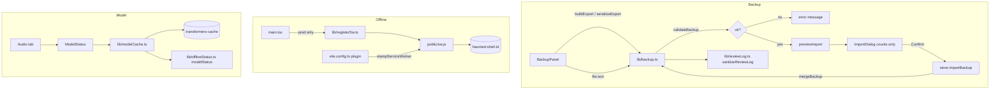
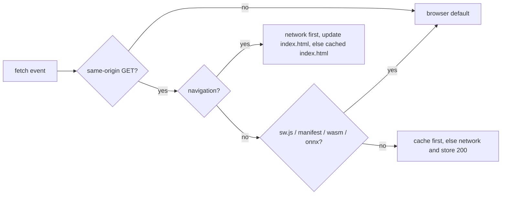

# Design Document

## Overview

Data Safety and Offline has three parts that share no runtime state:

1. **Backup**: a pure module `src/lib/backup.ts` builds, serializes, validates, sanitizes and merges backup data. A thin `BackupPanel` component downloads the file, reads a chosen file, shows a confirm dialog and calls one new store action.
2. **Offline shell**: a hand-written `public/sw.js`, a `public/manifest.webmanifest`, PNG icons, a tiny pure registration guard, and a small inline Vite plugin that stamps a build id and precache list into the built `sw.js`.
3. **Model status**: a pure `src/lib/offlineStatus.ts` decides from cached URLs whether the Whisper model is stored. A small `ModelStatus` component in the Audio tab shows the result.

Design decisions:

| Decision | Choice | Reason |
|---|---|---|
| Trust model | Imported file is hostile. The validator copies known keys into new objects and never spreads or assigns untrusted objects. | Prevents prototype pollution and unexpected keys by construction, not by filtering a blocklist. |
| Failure granularity | Envelope problems and limit breaches reject the file. A bad record inside limits is dropped and counted. | One damaged card should not block a restore, but a wrong app or version must. |
| Lookups | `Map` and `Set` only for values from the file. | Keys such as `__proto__` are harmless in a `Map`. |
| Merge policy | Existing data always wins. Incoming items are skipped on id match or card content match. | Satisfies "no duplicates, no loss". Makes merge idempotent. |
| Review events | Union keyed by `t`, `r`, `c`, then `sanitizeReviewLog`. | Reuses study-insights rules (cap 500, sort). |
| Dialog | Native `<dialog>` opened with `showModal()` | The browser supplies the focus trap, Escape handling and focus return. Less code to get wrong. |
| Dialog content | Counts and fixed warning text only | No file-derived text is rendered, so XSS and answer leaks have no path. |
| Service worker | Plain JS, 3 strategies (precache, network-first navigation, cache-first assets) | Minimal, readable, no Workbox. |
| Update path | Network-first navigations, `skipWaiting` after precache succeeds, `clients.claim`, delete old `haunted-shell-*` caches, `updateViaCache: 'none'` | Online users always get the newest HTML. A failed precache keeps the old worker. |
| Build stamping | Inline Vite plugin calling a pure `stampServiceWorker` | Content-hashed file names give a build id that changes whenever the bundle changes. Testable without a build. |
| Model readiness | Read keys of the `transformers-cache` Cache Storage bucket | The library stores model files there. No network, no import of the heavy library. |
| Persisted state | No new field | No migration needed (`tech.md`). |

Research notes: `@huggingface/transformers` v3 stores downloaded model files in the browser Cache API bucket `transformers-cache` (browser cache is on by default). The exact bucket name and file names are an internal detail. A task therefore inspects the real cache in the browser and fixes `REQUIRED_MODEL_FILES` if needed. Tesseract.js keeps language data in IndexedDB, so it needs no handling. Source: the library's `env.useBrowserCache` setting, documented at https://huggingface.co/docs/transformers.js/api/env. Content was rephrased for compliance with licensing restrictions.

## Architecture



Request flow in the service worker:



## Components and Interfaces

### `src/lib/backup.ts` (pure)

```ts
export const BACKUP_APP = 'haunted-notes';
export const BACKUP_SCHEMA_VERSION = 1;
export const BACKUP_LIMITS = {
  fileBytes: 5 * 1024 * 1024,
  notes: 500, flashcards: 5000, events: 5000,
  id: 100, rawText: 20000, title: 200, sentence: 1000, prompt: 1000, clozeWord: 100,
} as const;

export interface BackupData { notes: Note[]; flashcards: Flashcard[]; reviewLog: ReviewLog }
export interface ExportFile extends BackupData { app: string; schemaVersion: number; exportedAt: number }

export function buildExport(data: BackupData, now: number): ExportFile;      // copies exactly 3 data fields
export function serializeExport(file: ExportFile): string;                   // JSON.stringify(file, null, 2)
export function backupFileName(now: number, tzOffsetMinutes?: number): string; // haunted-notes-backup-YYYY-MM-DD.json
export function isFileSizeAllowed(bytes: number): boolean;                   // 0 <= bytes <= fileBytes

export type RejectReason =
  'not-json' | 'not-an-object' | 'wrong-app' | 'bad-version' |
  'unknown-version' | 'bad-shape' | 'too-many';
export type ImportWarning = 'review-log-ignored';

export interface DroppedCounts { notes: number; flashcards: number; events: number }
export type ValidateResult =
  | { ok: true; data: BackupData; dropped: DroppedCounts; warnings: ImportWarning[] }
  | { ok: false; reason: RejectReason };

export interface ValidateContext { existingNoteIds: ReadonlySet<string>; now: number }
export function parseBackupText(text: string, ctx: ValidateContext): ValidateResult;
export function validateBackup(raw: unknown, ctx: ValidateContext): ValidateResult;  // total, never throws

export interface ImportSummary {
  notes: { added: number; skipped: number };
  flashcards: { added: number; skipped: number };
  events: { added: number; skipped: number };
  dropped: DroppedCounts;
  warnings: ImportWarning[];
}
export interface MergeResult { data: BackupData; summary: ImportSummary }
export function mergeBackup(current: BackupData, incoming: BackupData,
  dropped?: DroppedCounts, warnings?: ImportWarning[]): MergeResult;
```

`isFileSizeAllowed(bytes)` returns true when `bytes` is a finite number from 0 to `fileBytes` inclusive.

**Validation steps** (`validateBackup`), wrapped in a single `try/catch` as a last line of defense that returns `{ ok: false, reason: 'bad-shape' }`:

1. `isPlainObject(raw)`: `typeof` is `object`, not `null`, not an array, and prototype is `Object.prototype` or `null`. Else `not-an-object`.
2. Read fields only with `Object.hasOwn(raw, key)` and then `raw[key]`. `app !== 'haunted-notes'` gives `wrong-app`.
3. `schemaVersion` not an integer gives `bad-version`. Not equal to 1 gives `unknown-version`.
4. `notes` and `flashcards` must be arrays, else `bad-shape`. Over the limit gives `too-many`. `reviewLog` is read later; if it is an object with an `events` array over 5000 items, `too-many`.
5. Notes: for each item, `sanitizeNote(item)` returns a new `Note` or `null`. Reject Forbidden_Key ids, duplicate ids (Set), invalid fields. Count dropped.
6. Cards: `sanitizeCard(item, now)` returns a new `Flashcard` or `null`. Check `noteId` is in the Set of accepted note ids or `ctx.existingNoteIds`, else count as dropped (orphan). Fill SRS defaults when all four SRS fields are absent. Duplicate ids are dropped.
7. Review log: if `reviewLog` is a plain object with `v` equal to `REVIEW_LOG_VERSION`, first pre-filter events with `r` of 1 to 100 characters and not a Forbidden_Key (count dropped), then call `sanitizeReviewLog`. If missing, treat as empty. If `v` is newer or the value is not an object, use `emptyReviewLog()` and add `review-log-ignored`.

`sanitizeNote` and `sanitizeCard` build the result with an object literal listing each known key. Strings are checked with `typeof === 'string'` and length. Numbers use `Number.isFinite` and range checks. A `title` that fails is omitted. No spread, `Object.assign`, `for...in` copy or reviver is used on untrusted values. `isForbiddenKey(s)` compares to the three names.

**Merge** (`mergeBackup`):

1. Build `noteIds = new Set(current ids)`. For each incoming note in order: if `noteIds` has the id, `skipped++`, else append and add the id, `added++`.
2. Build `cardIds` and `cardKeys` sets from current cards. The key is `JSON.stringify([noteId, sentence, clozeWord])`. For each incoming card: if id or key is present, `skipped++`, else append (the card object is reused, not mutated) and add both.
3. Events: `seen = Set` of `${t}|${r}|${c}` for current events. Incoming events not in `seen` are added to the union (`added`), others `skipped`. The union is `[...current.events, ...newOnes]` passed to `sanitizeReviewLog({ v, events })`.
4. Return the merged `BackupData` and the `ImportSummary`. `current` objects are never mutated and existing cards keep their identity.

### `src/lib/offlineStatus.ts` (pure)

```ts
export const WHISPER_MODEL_ID = 'Xenova/whisper-tiny.en';
export const REQUIRED_MODEL_FILES = ['config.json', 'tokenizer.json', 'encoder_model', 'decoder_model_merged'] as const;
export type ModelStatus = 'ready' | 'not-downloaded' | 'unknown';
/** 'ready' when every required name appears in at least one URL that contains `/<modelId>/`. */
export function modelStatus(cachedUrls: readonly string[], modelId?: string, required?: readonly string[]): 'ready' | 'not-downloaded';
```

### `src/lib/modelCache.ts` (I/O wrapper, not pure)

`readModelStatus(cacheStorage?: CacheStorage): Promise<ModelStatus>`. Returns `unknown` when `caches` is undefined or any call throws. Uses `caches.has('transformers-cache')` first so it never creates the bucket, then `open` and `keys()`, maps `request.url`, and calls `modelStatus`. Makes no `fetch` call and does not import `@huggingface/transformers`.

### `src/lib/swStamp.ts` (pure, no imports)

```ts
export const SW_BUILD_TOKEN = '__BUILD_ID__';
export const SW_PRECACHE_TOKEN = '"__PRECACHE_LIST__"';
export function stampServiceWorker(source: string, buildId: string, urls: readonly string[]): string;
export function makeBuildId(fileNames: readonly string[], hash: (s: string) => string): string;
export function selectPrecacheUrls(fileNames: readonly string[], extra: readonly string[]): string[];
```

`selectPrecacheUrls` keeps `index.html` and `assets/*.js|css` files, removes `.map`, `.wasm`, `.onnx`, `sw.js`, then appends `extra` (manifest, icons) and sorts. `stampServiceWorker` replaces the build token and the quoted precache token with `JSON.stringify(urls)`. It is imported by `vite.config.ts` (with the `.ts` extension, as the node tsconfig requires) and added to `tsconfig.node.json` includes if the compiler needs it.

### `vite.config.ts` plugin

A plugin object `{ name: 'haunted-sw-stamp', apply: 'build', writeBundle(options, bundle) }`. It computes the file names from `bundle`, builds the id with `crypto.createHash('sha256')` (Node built-in), reads `<outDir>/sw.js`, writes the stamped text back. It fails the build if a token is still present afterwards. `public/sw.js` is copied by Vite as a static file, so the stamp runs on the output copy only and the source keeps its tokens. In `vite dev` the file is served unstamped and never registered.

### `public/sw.js` (hand-written)

```js
const BUILD_ID = '__BUILD_ID__';
const PRECACHE = "__PRECACHE_LIST__";           // replaced by a JSON array at build time
const PREFIX = 'haunted-shell-';
const CACHE = PREFIX + BUILD_ID;
```

- `install`: `event.waitUntil(precache().then(() => self.skipWaiting()))`. `precache` opens `CACHE` and for each URL (resolved against `self.registration.scope`) fetches with `cache: 'reload'`, throws on a non-200, and puts it. Any failure rejects `waitUntil`, so the install fails and the old worker stays.
- `activate`: delete caches that start with `PREFIX` and are not `CACHE`; then `clients.claim()`. It never touches other names.
- `fetch`: ignore non-GET, cross-origin, `sw.js`, `manifest.webmanifest`, and paths ending `.wasm`, `.onnx`, `.traineddata`. Navigations: `fetch(request)` then put a clone of a 200 response under the cached `index.html` key, else `caches.match(indexUrl)`. Assets: `caches.match` then network; store only a 200 same-origin response.
- Dead code is avoided: no `message` handler, no background sync.
- When `BUILD_ID` still equals the literal token (unstamped, for instance when served by `vite dev`), the worker calls `self.registration.unregister()` on activate. This guard is one more safety net behind the production-only registration.

### `src/lib/registerSw.ts`

```ts
export function shouldRegisterSw(env: { prod: boolean; hasServiceWorker: boolean; secure: boolean }): boolean;
export function registerServiceWorker(): void;   // reads import.meta.env.PROD, navigator, isSecureContext
```

`registerServiceWorker` returns at once if `shouldRegisterSw` is false. Otherwise it adds a `load` listener that calls `navigator.serviceWorker.register(new URL('sw.js', document.baseURI).href, { scope: new URL('./', document.baseURI).pathname, updateViaCache: 'none' })`, with `.catch` logging `console.warn('Service worker registration failed')` once. `main.tsx` calls it after `createRoot(...).render(...)`.

### Manifest, icons and `index.html`

`public/manifest.webmanifest`:

```json
{
  "name": "Haunted Notes", "short_name": "Haunted",
  "start_url": "./", "scope": "./", "display": "standalone",
  "background_color": "#0d0d14", "theme_color": "#0d0d14",
  "icons": [
    { "src": "icons/icon-192.png", "sizes": "192x192", "type": "image/png" },
    { "src": "icons/icon-512.png", "sizes": "512x512", "type": "image/png" },
    { "src": "icons/icon-maskable-512.png", "sizes": "512x512", "type": "image/png", "purpose": "maskable" }
  ]
}
```

`scripts/make-icons.mjs` draws a ghost on a `#0d0d14` background into an RGBA buffer, encodes PNG chunks by hand (CRC32 table and `zlib.deflateSync`) and writes the three files. The maskable icon keeps the ghost inside the central 80% safe zone. The icons are committed, so the script runs once, not in the build. `index.html` gets `<link rel="manifest" href="manifest.webmanifest">` and `<link rel="apple-touch-icon" href="icons/icon-192.png">`.

### Store (`src/store/useStore.ts`)

New action only:

```ts
importBackup: (data: BackupData) => ImportSummary;
```

It runs `mergeBackup(current, data)` on `{ notes, flashcards, reviewLog }` from `get()`, then one `set({ notes, flashcards, reviewLog })`, and returns the summary. UI settings are not touched. Because the dialog already showed a preview, the action recomputes the merge from the latest state so a change between preview and confirm cannot cause duplicates.

### Components

`src/components/BackupPanel.tsx` (section "Backup and restore", heading, two buttons, a live region):

- Export: `buildExport({ notes, flashcards, reviewLog }, Date.now())`, `serializeExport`, a `Blob` of type `application/json`, `URL.createObjectURL`, a temporary `<a download>` click, `URL.revokeObjectURL`. Status message "Exported N notes and M cards."
- Import: a visually hidden `<input type="file" accept=".json,application/json">` triggered by the Import button; `onChange` checks `isFileSizeAllowed(file.size)`, reads `file.text()` in `try/catch`, calls `parseBackupText`, and on success calls `mergeBackup` on the current data for a preview only, then opens the dialog. The input value is reset after each read.
- Maps `RejectReason` and `ImportWarning` to fixed strings in a lookup object. No file text is shown.

`src/components/ImportDialog.tsx`: a `<dialog aria-labelledby>` opened with `showModal()` in an effect. It lists "Notes: N new, N already here, N invalid" and the same for cards and review events, then warnings. Buttons: Cancel (`autoFocus`) and, only when something is new, "Merge into my notes". The `cancel` event and the Cancel button close it. Native modal behavior traps focus and restores focus to the Import button.

`src/components/ModelStatus.tsx`: reads `readModelStatus()` in an effect when mounted and again when the `refreshKey` prop changes. Renders an icon plus text: "Whisper model ready offline", "Whisper model not downloaded yet (one-time download needed)" or "Offline model status unknown". It is mounted by `AddNoteView` inside the Audio tab, passing the Whisper load state as `refreshKey`.

`DashboardView.tsx` renders `<BackupPanel />` below the room list and also on the `EmptyState` path.

### CSS (`src/index.css`)

New classes `.backup-panel`, `.backup-actions`, `.backup-status`, `.backup-dialog`, `.backup-dialog::backdrop`, `.backup-counts`, `.model-status`. Only existing tokens. The backdrop uses `color-mix(in srgb, var(--bg) 80%, transparent)`. Buttons reuse `.btn-secondary` and `.btn-primary`, so the 44px mobile rule applies. Mobile first: the actions stack at 390px and sit in a row from `min-width: 640px`. No `@keyframes` or transitions are added, so the reduced-motion block needs no new entry.

## Data Models

Export file (example):

```json
{
  "app": "haunted-notes",
  "schemaVersion": 1,
  "exportedAt": 1731400000000,
  "notes": [{ "id": "note-1731-ab12c", "rawText": "...", "inputMethod": "type", "createdAt": 1731390000000, "title": "Biology" }],
  "flashcards": [{ "id": "card-1", "noteId": "note-1731-ab12c", "sentence": "...", "clozeWord": "...", "prompt": "...",
    "weaknessScore": 0.5, "streakCorrect": 0, "streakWrong": 0, "lastReviewed": null,
    "ease": 2.5, "intervalDays": 0, "dueAt": 1731390000000, "reps": 0 }],
  "reviewLog": { "v": 1, "events": [{ "t": 1731400000000, "r": "note-1731-ab12c", "c": 1 }] }
}
```

Size: with the limits, the worst case is about 500 x 20 KB + 5000 x 2.2 KB, roughly 21 MB of characters, but the file limit of 5 MiB applies first, so the practical cap is 5 MiB.

Service worker cache names: `haunted-shell-<12 hex characters>`. Precache list: about 20 to 40 same-origin URLs.

## Correctness Properties

*A property is a characteristic or behavior that should hold true across all valid executions of a system-essentially, a formal statement about what the system should do. Properties serve as the bridge between human-readable specifications and machine-verifiable correctness guarantees.*

Reflection: the prework items for envelope fields, no clock read and excluded settings (1.2, 1.3, 1.7) merge into Property 1. Round trip, valid JSON, order and review log fidelity (2.1, 2.2, 2.3, 9.1) merge into Property 2. Existing-unchanged, skip-duplicates and append-order (8.1 to 8.4, 8.8) merge into Property 8. The "never throws" items (3.6, 5.8, 15.5) merge into Property 4.

### Property 1: Export envelope is exact and deterministic

For any Backup_Data and any time `now`, `buildExport(data, now)` has exactly the keys `app`, `schemaVersion`, `exportedAt`, `notes`, `flashcards` and `reviewLog`, with `app` equal to `haunted-notes`, `schemaVersion` equal to 1, `exportedAt` equal to `now`, and the three data fields equal to the input; calling it twice gives equal results.

**Validates: Requirements 1.2, 1.3, 1.7**

### Property 2: Export round trip

For any valid Backup_Data and any time, `validateBackup(JSON.parse(serializeExport(buildExport(data, now))), ctx)` returns `ok` with data deep-equal to the original, in the same order, and with zero dropped items and no warnings.

**Validates: Requirements 2.1, 2.2, 2.3, 9.1**

### Property 3: Backup file name and size check

For any `now` and `tzOffsetMinutes`, `backupFileName` matches `haunted-notes-backup-\d{4}-\d{2}-\d{2}\.json` and its date equals the local date of `now`; for any byte count, `isFileSizeAllowed` is true exactly when the count is from 0 to 5 MiB.

**Validates: Requirements 1.4, 3.2**

### Property 4: Validation is total

For any value from `fc.anything()`, any string, and any JSON text produced by `JSON.stringify` of generated values, `parseBackupText` and `validateBackup` return a result object and do not throw, and a result with `ok` false has a `reason` from the defined list.

**Validates: Requirements 3.3, 3.6, 5.8, 15.5**

### Property 5: Envelope defects are rejected with the right reason

For any valid export with exactly one envelope defect (not an object, wrong `app`, non-integer version, an integer version other than 1, `notes` or `flashcards` not an array, or a count over the limit), validation rejects the file with the matching reason.

**Validates: Requirements 4.1, 4.2, 4.3, 4.4, 4.5, 4.6, 9.6**

### Property 6: Invalid records are dropped and the rest kept

For any list that mixes valid and invalid notes and cards (wrong types, over-length strings, out-of-range numbers, orphan `noteId`, duplicate ids, Forbidden_Key ids), the result contains exactly the valid records in file order, every accepted card references an accepted note or a note in `existingNoteIds`, all ids are unique, and the dropped counts equal the number of invalid records.

**Validates: Requirements 4.7, 4.8, 4.9, 4.10, 4.12, 5.4, 9.5**

### Property 7: Output contains only known keys and no pollution

For any export whose records carry extra keys, including `__proto__`, `constructor` and `prototype` set as own keys through `JSON.parse`, every accepted note, card, event and review log has exactly its known keys, no result object at any depth has a Forbidden_Key as an own key, and `Object.prototype` has the same property names before and after validation.

**Validates: Requirements 5.1, 5.2, 5.3, 5.7**

### Property 8: Merge preserves existing data and adds each new item once

For any current Backup_Data and any valid incoming Backup_Data, the merged notes and flashcards begin with the current ones, unchanged (same objects, same order), followed by only those incoming items whose `id` is new and, for cards, whose `noteId`, `sentence` and `clozeWord` combination is new, in file order.

**Validates: Requirements 8.1, 8.2, 8.3, 8.4, 8.8**

### Property 9: Merge result has no duplicates

For any current and incoming Backup_Data where current has no duplicates, the merged result has no two notes with the same `id`, no two cards with the same `id`, and no two cards with the same `noteId`, `sentence` and `clozeWord`.

**Validates: Requirements 8.5**

### Property 10: Merge is idempotent

For any current and incoming Backup_Data, merging the incoming data into the result of a first merge gives the same notes, flashcards and review log as the first merge.

**Validates: Requirements 8.6**

### Property 11: Summary counts add up

For any current and incoming Backup_Data, `summary.notes.added + summary.notes.skipped` equals the number of incoming notes, the same holds for flashcards and for events, and `added` equals the growth in the merged list length (before the 500-event cap for events).

**Validates: Requirements 8.7, 7.2**

### Property 12: Merged review log is valid, sorted and capped

For any current and incoming review logs, the merged log has `v` equal to `REVIEW_LOG_VERSION`, at most 500 events, events ordered by `t` non-decreasing, and when the union of distinct events has 500 or fewer items, the merged log contains every distinct event from both logs.

**Validates: Requirements 9.2, 9.4**

### Property 13: Newer or malformed review log is ignored with a warning

For any export whose `reviewLog` is not an object or has a `v` above `REVIEW_LOG_VERSION`, validation returns `ok` with an empty review log, the warning `review-log-ignored`, and all valid notes and cards intact.

**Validates: Requirements 9.3**

### Property 14: Model status matches the cached files

For any list of URLs, `modelStatus` returns `ready` exactly when every required file name appears in some URL that contains the model id path segment, and `not-downloaded` otherwise; adding unrelated URLs never changes the result.

**Validates: Requirements 13.2, 13.3, 13.4**

### Property 15: Service worker stamping replaces both tokens

For any non-empty build id of hex characters and any list of URLs, `stampServiceWorker` applied to the real `public/sw.js` source returns text with no remaining token, containing the build id, and whose precache array parses with `JSON.parse` to the given list.

**Validates: Requirements 12.1, 12.8**

### Property 16: Precache selection keeps only shell files

For any list of file names, `selectPrecacheUrls` returns a sorted list without duplicates, containing no `.map`, `.wasm`, `.onnx` or `sw.js` entry, and containing every `index.html` and `assets/*.js|css` name from the input.

**Validates: Requirements 10.9, 12.1**

## Error Handling

| Situation | Handling |
|---|---|
| File over 5 MiB | Rejected before reading. Message names the limit. Store unchanged. |
| Unreadable file or invalid JSON | Message "That file could not be read" or "not valid JSON". Store unchanged. |
| Wrong app, unknown or bad version, bad shape, too many items | Whole file rejected with a fixed message per reason. |
| Invalid record inside limits | Dropped, counted in the summary. |
| Newer `reviewLog.v` | Log ignored, warning shown, other data imported. |
| Hostile keys (`__proto__` and others) | Never copied. Records with such ids are dropped. |
| Nothing new to add | Dialog says so and offers only Cancel. |
| Store changed between preview and confirm | `importBackup` merges against the latest state. |
| Export in a browser that blocks downloads | Status message is shown; no data is lost because the Store is not changed by export. |
| `serviceWorker` unsupported, insecure context, dev build | No registration, app works as before. |
| Registration rejects | One `console.warn`, app continues. |
| Precache fetch fails during install | Install fails; the previous worker and cache stay. |
| Offline navigation with no cached `index.html` | Browser default offline page (only before the first successful install). |
| `caches` missing or throws | `ModelStatus` shows "Offline model status unknown". |
| Stale cache from an old build | Deleted on activate (prefix match only). |
| Unstamped `sw.js` reaches a browser | Worker unregisters itself on activate. |

## Testing Strategy

Property-based testing applies to `backup.ts`, `offlineStatus.ts` and `swStamp.ts` (pure functions with large input spaces). It does not apply to the components, `sw.js` runtime behavior, the manifest or the icons; those use example tests, source scans and browser verification.

**Property tests** (`fast-check` 4.10.2, already installed):

- Files: `src/lib/backup.test.ts`, `src/lib/offlineStatus.test.ts`, `src/lib/swStamp.test.ts`, beside the modules.
- Each Correctness Property is one `fc.assert(fc.property(...))` test with `numRuns` of at least 100 and a comment tag `Feature: data-safety-offline, Property N: <title>`.
- Generators: valid `Note`, `Flashcard`, `ReviewEvent` and `BackupData` arbitraries; mutators that apply one defect; hostile JSON built by `JSON.parse` of strings that contain `"__proto__"`, `"constructor"` and `"prototype"` keys at several depths; `fc.anything()` and `fc.string()` for totality.
- Pass `now` explicitly everywhere. No test reads the real clock.

**Unit tests** (vitest), examples and edge cases:

- `backup`: empty export; file of exactly 5 MiB allowed and 5 MiB + 1 rejected; each reject reason with a hand-written file; legacy card without SRS fields gets defaults; a title of 201 characters drops only the title; the string `{"__proto__":{"polluted":1}}` leaves `({}).polluted` undefined; merge of a card with the same content but a new id is skipped; existing SRS fields survive a matching incoming card.
- `store`: `importBackup` changes only the three data fields and returns the summary; UI settings are unchanged; a second call adds nothing.
- `offlineStatus`: ready, partly downloaded and empty lists. `modelCache` with a fake `CacheStorage`: missing bucket gives `not-downloaded` without creating it; a throwing `open` gives `unknown`; no `caches` gives `unknown`.
- `registerSw`: `shouldRegisterSw` false in dev, without `serviceWorker`, and in an insecure context; true in production over a secure context.
- Source scans (read files as text in vitest): `BackupPanel.tsx`, `ImportDialog.tsx` and `ModelStatus.tsx` contain none of `dangerouslySetInnerHTML`, `innerHTML`, `outerHTML`, `insertAdjacentHTML`, `document.write`; `backup.ts` contains no `Object.assign`, no spread of untrusted values and no `Date.now`; `sw.js` has no reference to `transformers-cache`, no hosts for the model or Tesseract, and deletes only names starting with `haunted-shell-`; `package.json` dependency lists equal their previous values.
- Manifest and icons: JSON fields present; the three PNG files exist with the expected width and height read from the IHDR chunk; theme color equals `#0d0d14`.
- Components with `react-dom/server`: `BackupPanel` renders two buttons, a file input with `accept`, and an `aria-live` region; `ImportDialog` renders counts and warnings only, with a hostile file name never rendered; no unique Answer_Text marker from seeded cards appears in any markup; `ModelStatus` renders each of the three statuses with text.

**Browser verification** (Playwright, run by the implementing agent after `npm run build` and `npm run preview`): load, wait for the worker to control the page, check the manifest and the icons, go offline, reload, press Try demo, answer one quiz question, and also confirm that `npm run dev` registers no worker. The Whisper cache keys are read in the browser to confirm `REQUIRED_MODEL_FILES`. Results go into `haunted-notes/KIRO_LOG.md`; if any step cannot run, it is logged as UNVERIFIED with the reason. The `ghost-ui-reviewer` agent reviews `BackupPanel`, `ImportDialog` and `ModelStatus` for contrast, 44px targets, focus and 390px layout.
