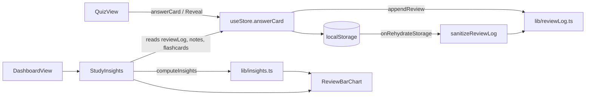

# Design Document

## Overview

Study Insights adds a progress panel to the Dashboard. The statistics come from a compact review log kept in the existing Zustand store and persisted to localStorage. All logic is in two pure modules, `src/lib/reviewLog.ts` (append, cap, sanitize) and `src/lib/insights.ts` (streak, today count, 7-day accuracy, daily buckets, bar heights, weakest rooms). Two thin components render the result: `StudyInsights` (panel) and `ReviewBarChart` (plain SVG with a visually hidden table).

Design decisions:

| Decision | Choice | Reason |
|---|---|---|
| Where the log lives | A `reviewLog` field in the existing `haunted-notes-storage` entry | One persisted object, one migration hook, matches `tech.md` ("State and actions live only in `useStore.ts`"). |
| Event shape | `{ t, r, c }` with `c` as `0 \| 1` | About 50 bytes per event in JSON, so 500 events is about 25 KB. No card text, so no answer can leak. |
| Version handling | `v` inside the log object, not the Zustand `version` option | The store has no `version` today. A field inside the log versions only this data and leaves notes and flashcards untouched. |
| Corrupt data | One total function `sanitizeReviewLog(unknown)` | Never throws, always returns a valid log, so no UI code needs a guard. |
| Weakest rooms | Average `weaknessScore` of unbanished cards | Same definition as the existing `roomSortWeight` in `DashboardView`, so the panel and the "weakest" sort agree. |
| Day boundary | Local day via `tzOffsetMinutes` parameter | Keeps functions pure and tests independent of the machine timezone. |
| Chart | Hand-written SVG, no animation | No dependency, and nothing to disable for reduced motion. |
| Property-test library | `fast-check` 4.10.2 (already installed) | Required by `testing.md`. |

Research notes: no external research was needed. The design reuses `isBanished` from `src/lib/srs.ts`, the `.sr-only` class and tokens in `src/index.css`, and the `onRehydrateStorage` pattern in `useStore.ts`. Known limitation: one `tzOffsetMinutes` value is used for the whole 7-day window, so a daylight-saving change inside the window can shift a day boundary by one hour. This is accepted for a study streak.

## Architecture



Data flow for a review: `answerCard` finds the card, applies the existing weakness and SRS updates, then calls `appendReview(log, { t: Date.now(), r: card.noteId, c })`. The store is the only place that reads the clock for events. The panel reads `Date.now()` once per render and passes it as `now`.

## Components and Interfaces

### `src/types.ts` additions

```ts
/** One review: time (ms), room (note) id, correct flag. */
export interface ReviewEvent {
  t: number;
  r: string;
  c: 0 | 1;
}

export interface ReviewLog {
  /** Schema version of this object. */
  v: number;
  /** Oldest first, at most 500. */
  events: ReviewEvent[];
}
```

### `src/lib/reviewLog.ts` (pure)

```ts
export const REVIEW_LOG_VERSION = 1;
export const REVIEW_EVENT_CAP = 500;

export function emptyReviewLog(): ReviewLog;
/** Returns a new log with the event appended and the oldest events dropped over the cap. */
export function appendReview(log: ReviewLog, event: ReviewEvent): ReviewLog;
/** Total function: any input becomes a valid, sorted, capped log of the current version. */
export function sanitizeReviewLog(raw: unknown): ReviewLog;
```

`sanitizeReviewLog` steps:

1. If `raw` is not a plain object, return `emptyReviewLog()`.
2. Read `v`. If it is not an integer, or is greater than `REVIEW_LOG_VERSION`, return `emptyReviewLog()`.
3. If `events` is not an array, return `emptyReviewLog()`.
4. If `v < REVIEW_LOG_VERSION`, pass the array through `migrateEvents(v, events)`. Version 1 is the first version, so the only migration is `v = 0`, which accepts the same event shape (a pre-release shape). The step table is a small `Record<number, (e: unknown[]) => unknown[]>` so a future version adds one entry.
5. Keep items where `t` is a finite number greater than or equal to 0, `r` is a non-empty string, and `c` is 0 or 1. Copy them into new objects with exactly the keys `t`, `r`, `c`.
6. Stable sort by `t` ascending. Keep the last `REVIEW_EVENT_CAP` items.
7. Return `{ v: REVIEW_LOG_VERSION, events }`.

### `src/lib/insights.ts` (pure)

```ts
export const MS_PER_DAY = 86_400_000;
export const WINDOW_DAYS = 7;
export const WEAKEST_ROOM_COUNT = 3;

/** Local calendar day number. tzOffsetMinutes is the value of Date#getTimezoneOffset(). */
export function dayIndex(t: number, tzOffsetMinutes: number): number;

export function currentStreak(events: ReviewEvent[], now?: number, tzOffsetMinutes?: number): number;
export function reviewedToday(events: ReviewEvent[], now?: number, tzOffsetMinutes?: number): number;
/** 0..1, or null when the window has no events. */
export function accuracy7d(events: ReviewEvent[], now?: number, tzOffsetMinutes?: number): number | null;

export interface DayBucket { dayKey: number; label: string; reviews: number; correct: number }
/** Exactly 7 buckets, oldest first, the last one is today. */
export function dailyBuckets(events: ReviewEvent[], now?: number, tzOffsetMinutes?: number): DayBucket[];

/** Heights in [0, plotHeight]; the largest count gets plotHeight; zero gets 0. */
export function barHeights(counts: number[], plotHeight: number): number[];

export interface WeakRoom { noteId: string; weakness: number }
export function weakestRooms(
  notes: { id: string }[],
  cards: (SrsFields & { noteId: string; weaknessScore: number })[],
  now?: number,
  limit?: number,
): WeakRoom[];

export interface Insights {
  streak: number;
  today: number;
  accuracy: number | null;
  buckets: DayBucket[];
  weakest: WeakRoom[];
}
export function computeInsights(input: {
  events: ReviewEvent[];
  notes: { id: string }[];
  cards: (SrsFields & { noteId: string; weaknessScore: number })[];
  now?: number;
  tzOffsetMinutes?: number;
}): Insights;
```

Rules:

- `dayIndex(t, tz) = Math.floor((t - tz * 60_000) / MS_PER_DAY)`.
- Events with `t > now` are ignored by every function.
- `currentStreak`: build the set of day indexes. Let `today = dayIndex(now)`. Start at `today` if it is in the set, else at `today - 1` if it is in the set, else return 0. Walk backward while the day is in the set. Because the set is finite, the walk ends.
- `accuracy7d`: events with `today - 6 <= dayIndex <= today` and `t <= now`. Return `null` when none, else `correct / total`.
- `dailyBuckets`: for `i = 6..0`, day `today - i`; `label` is the short weekday name from the day index (computed without `Date.now()`, using `new Date(dayIndex * MS_PER_DAY)` in UTC so it is deterministic).
- `barHeights`: `max = Math.max(0, ...counts)`; if `max === 0` return all zeros; else `counts[i] / max * plotHeight`.
- `weakestRooms`: for each note, take cards with that `noteId` and `!isBanished(card, now)`; skip the room if none; weakness is the mean `weaknessScore`; sort by weakness descending then `noteId` ascending; slice to `limit` (default 3).
- Default parameter values: `now = Date.now()`, `tzOffsetMinutes = 0`. The component passes both explicitly.

### Store changes (`src/store/useStore.ts`)

- New state: `reviewLog: ReviewLog`, default `emptyReviewLog()`.
- `answerCard`: look up the card first. If it does not exist, return without touching `reviewLog`. Otherwise do the existing update and set `reviewLog: appendReview(state.reviewLog, { t: Date.now(), r: card.noteId, c: correct ? 1 : 0 })` in the same `set` call.
- `resetAll`: also sets `reviewLog: emptyReviewLog()`.
- `onRehydrateStorage`: keep the existing SRS migration. Add `state.reviewLog = sanitizeReviewLog(state.reviewLog)` as a separate step, and apply both with the existing assign-on-state pattern. A missing field (`undefined`) becomes an empty log. Zustand already falls back to defaults if the stored JSON itself cannot be parsed.
- No change to `partialize`, so the whole state including `reviewLog` is persisted as before.

### Components

`src/components/StudyInsights.tsx`

- A `<section aria-labelledby={headingId}>` with a heading "Study insights".
- Reads `reviewLog`, `notes` and `flashcards` from the store. Calls `computeInsights({ ..., now: Date.now(), tzOffsetMinutes: new Date().getTimezoneOffset() })`. Wraps this in `useMemo` keyed on the three store values.
- A `<dl>` of three stats: streak ("N day streak"), reviewed today ("N reviewed today"), accuracy ("N% accuracy, 7 days" or "No reviews yet"). Every statistic is visible text.
- A "Weakest rooms" list `<ol>`. Each item shows the room title and "weakness N%". The title text comes from an exported `noteTitle` helper moved unchanged from `DashboardView` into `src/lib/noteTitle.ts`, so both use the same text (a move, covered by a task).
- Renders `ReviewBarChart` with the buckets.
- No buttons, so there are no new tap targets. No `aria-live`.

`src/components/ReviewBarChart.tsx`

- Props: `buckets: DayBucket[]`.
- `<svg viewBox="0 0 280 120" role="img" aria-label="Reviews per day, last 7 days: N in total">` containing a baseline `<rect>`, 7 bar `<rect>` elements, 7 weekday `<text>` labels and 7 count `<text>` labels above the bars. Width is `100%` with `max-width`, height auto, so no horizontal scroll at 390px.
- Heights come from `barHeights`. A zero count draws a zero-height rect and the count label "0", so a value is never shown by color or height alone.
- Next to the SVG: `<table className="sr-only">` with a `<caption>`, header row "Day, Reviews, Correct" and 7 body rows.
- When the 7 counts are all 0, a visible `<p>` "No reviews in the last 7 days" is shown under the chart.
- Fill uses `var(--accent)` for bars, `var(--track)` for the baseline, `var(--text-muted)` and `var(--text)` for labels, set in CSS classes, not inline colors. No transitions.

`DashboardView.tsx`: render `<StudyInsights />` between the summary bar and the sort controls when `notes.length > 0`. The existing `EmptyState` path is unchanged.

### CSS (`src/index.css`)

New classes: `.insights`, `.insights-stats`, `.insights-stat`, `.insights-weak`, `.insights-weak li`, `.insights-chart`, `.chart-bar`, `.chart-baseline`, `.chart-label`. Mobile-first: stats stack in one column at 390px and switch to three columns at `min-width: 640px`. Only existing tokens are used. Because the chart has no animation or transition, no reduced-motion override is needed; the reduced-motion block is checked in a task to confirm nothing new needs adding.

## Data Models

Stored under the existing key `haunted-notes-storage`:

```json
{
  "state": {
    "notes": [], "flashcards": [],
    "reviewLog": { "v": 1, "events": [{ "t": 1731400000000, "r": "note-1731-ab12c", "c": 1 }] }
  },
  "version": 0
}
```

Size: an event is about 55 bytes, so the cap of 500 events is about 28 KB.

## Correctness Properties

*A property is a characteristic or behavior that should hold true across all valid executions of a system-essentially, a formal statement about what the system should do. Properties serve as the bridge between human-readable specifications and machine-verifiable correctness guarantees.*

Reflection: the prework items for cap, order, no mutation and event shape (1.6, 2.1, 2.3, 2.5, 3.3) are merged into Property 1. Sanitizer validity, cap, sort and no-throw (2.2, 4.2, 4.6, 4.7) are merged into Property 2. Accuracy and the daily buckets share a window, so Property 9 states the link between them.

### Property 1: Append keeps the cap, order and event shape

For any valid Review_Log and any valid Review_Event, `appendReview` returns a new log whose events number `min(n + 1, 500)`, equal the last 500 items of the old events followed by the new event, each have exactly the keys `t`, `r` and `c`, and the input log is unchanged.

**Validates: Requirements 1.6, 2.1, 2.2, 2.3, 2.5, 3.3**

### Property 2: Sanitizing any input yields a valid log

For any value, including arbitrary JSON, `undefined` and `null`, `sanitizeReviewLog` does not throw and returns a log with `v` equal to 1, at most 500 events, every event valid, and events sorted by `t` non-decreasing.

**Validates: Requirements 2.2, 4.1, 4.2, 4.4, 4.6, 4.7**

### Property 3: Sanitizing keeps valid events and drops invalid ones

For any list that mixes valid Review_Events with invalid items, `sanitizeReviewLog({ v: 1, events })` returns exactly the valid events, stable-sorted by `t`, limited to the newest 500.

**Validates: Requirements 2.4, 4.3**

### Property 4: Log serialization round trip

For any valid Review_Log, `sanitizeReviewLog(JSON.parse(JSON.stringify(log)))` equals the log.

**Validates: Requirements 3.4**

### Property 5: Streak matches the reference model and is never negative

For any list of events, any `now` and any `tzOffsetMinutes`, `currentStreak` is an integer greater than or equal to 0 and equals the length of the run of consecutive Local_Days, ending today or yesterday, computed by a simple reference implementation. An empty list gives 0.

**Validates: Requirements 5.2, 5.3, 5.4, 5.5, 5.6**

### Property 6: Streak ignores future events and never drops when today is added

For any list of events and any `now`, appending events later than `now` does not change `currentStreak`, and appending an event at `now` gives a streak greater than or equal to the previous streak.

**Validates: Requirements 5.7, 5.4**

### Property 7: Reviewed-today count matches the reference

For any list of events, any `now` and any `tzOffsetMinutes`, `reviewedToday` equals the number of events with `t <= now` on today's Local_Day, and is at most the number of events.

**Validates: Requirements 6.1, 6.2**

### Property 8: Accuracy is null or between 0 and 1

For any list of events, any `now` and any `tzOffsetMinutes`, `accuracy7d` is `null` exactly when the 7-day window has no events, otherwise a number from 0 to 1 inclusive equal to correct divided by total in the window, and never `NaN`.

**Validates: Requirements 7.1, 7.2, 7.3, 7.4, 10.3**

### Property 9: Daily buckets cover seven days and agree with accuracy

For any list of events, any `now` and any `tzOffsetMinutes`, `dailyBuckets` returns exactly 7 buckets with consecutive `dayKey` values ending today, each with `correct <= reviews`, and the sum of `reviews` equals the number of events in the accuracy window.

**Validates: Requirements 9.1, 7.4**

### Property 10: Bar heights are bounded and proportional

For any array of non-negative counts and any positive plot height, every height is between 0 and the plot height, a count of 0 gives height 0, and if any count is above 0 the largest count gets exactly the plot height.

**Validates: Requirements 9.3, 9.7**

### Property 11: Weakest rooms are bounded, ordered and non-empty

For any notes, cards and `now`, `weakestRooms` returns at most 3 rooms, ordered by weakness non-increasing, each with at least one unbanished card, each weakness between 0 and 1, and each `noteId` present in the notes.

**Validates: Requirements 8.1, 8.2, 8.3, 8.6**

## Error Handling

| Situation | Handling |
|---|---|
| localStorage entry is not valid JSON | Zustand's persist falls back to default state; the log is empty. |
| `reviewLog` missing, wrong type, wrong version or has junk items | `sanitizeReviewLog` returns a valid log, dropping only what is invalid. |
| Stored `v` is newer than the app understands | The log is reset to empty so an old build never misreads newer data. Notes and flashcards are not touched. |
| `answerCard` called for an unknown card id | No state change and no event. |
| No events | `accuracy7d` is `null`; the panel shows "No reviews yet". No division by zero. |
| Events after `now` (clock changed) | Ignored by all statistics. |
| Events for deleted notes | Count toward streak, today and accuracy, never listed in weakest rooms. |
| localStorage full | Not handled specially; the cap keeps the log near 28 KB. |

## Testing Strategy

Property-based testing applies to `reviewLog.ts` and `insights.ts` (pure functions with large input spaces). It does not apply to the components or CSS; those use example render tests and a manual or reviewer check.

**Property tests** (`fast-check` 4.10.2, no new dependency):
- Files: `src/lib/reviewLog.test.ts` and `src/lib/insights.test.ts`, beside the modules.
- Each Correctness Property is one `fc.assert(fc.property(...))` test with `numRuns: 100` or more.
- Each test has a comment tag: `Feature: study-insights, Property N: <title>`.
- Tests pass `now` and `tzOffsetMinutes` explicitly. Time-bound generators build events relative to `now` (for example `now - k * MS_PER_DAY` plus an offset within the day) so window edges are exercised. The reference models for streak, today count and accuracy are simple loops written in the test file.
- Generators include empty arrays and, for Property 2, `fc.anything()` and `fc.jsonValue()`.

**Unit tests** (vitest), examples and edge cases:
- `reviewLog`: empty log; append at exactly 500 drops the oldest; `v` 2 resets; `v` 0 upgrades; `null`, a string and an array root give an empty log; one bad item among good ones.
- `insights`: streak of 3 with today; streak continues from yesterday; streak 0 after a 2-day gap; accuracy 3 of 4 is 0.75; an event exactly 7 days ago is outside the window; weakest rooms with ties; a room with only banished cards is excluded; weekday labels for a fixed `now`.
- Store: `answerCard` correct and wrong append events with the right `c` and `r`; an unknown id appends nothing; `resetAll` clears the log; rehydrate with a missing or corrupt `reviewLog` yields an empty log and keeps flashcards.
- Components (`react-dom/server`, no new dependency): `ReviewBarChart` renders only `svg`, `rect` and `text` inside the SVG, has `role="img"`, an `aria-label`, 7 table rows in a `.sr-only` table and the empty message when all counts are 0. `StudyInsights` shows "No reviews yet" for an empty log, shows no `clozeWord` or `sentence` text (unique marker strings in the test data), and has no `aria-live`.

**Non-automated checks:** run the `ghost-ui-reviewer` agent on `StudyInsights` and `ReviewBarChart` for contrast, 390px layout and reduced motion. Run `npm run build`, `npm run lint` and `npm test`.
